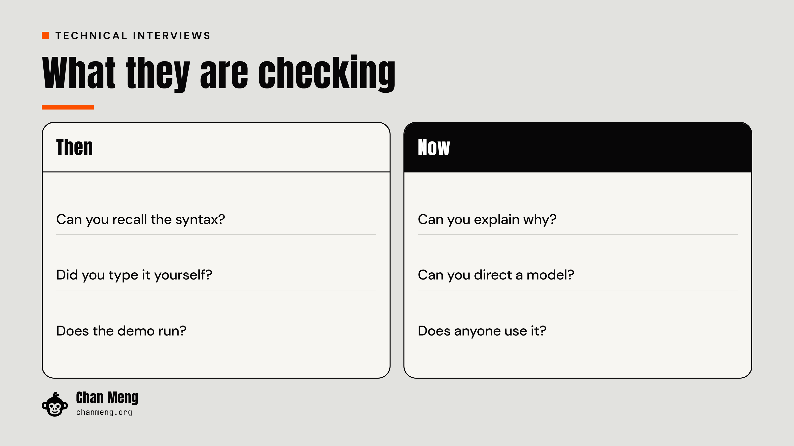
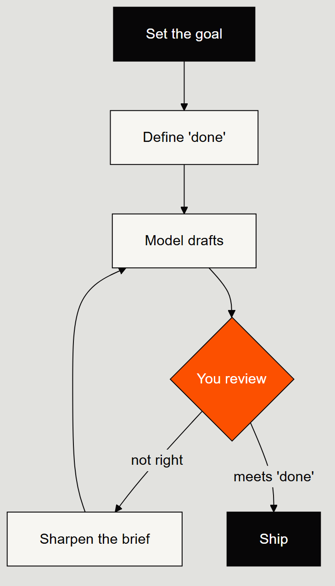

# linkedin-post — a Claude Code skill for LinkedIn and X posts

A [Claude Code](https://claude.com/claude-code) **skill** that takes one of your ideas and turns it
into a post that specialists believe, non-specialists follow, and people finish. It writes for
LinkedIn, for X, or for both, adds a diagram or a rendered image when the content has a shape worth
seeing, and hands you **one markdown file**. It **never touches LinkedIn or X**: no browser
automation, no composer. You copy, tag, attach, publish.

```
/linkedin-post idea      # or: story / take / recap   (or just describe what you want)
```

## What it is built on

**A studied voice.** `references/voice.md` is a writing system distilled from two LinkedIn writers
the author likes reading: one who writes from lived moments, one who writes as an operator
reporting what he found. It gives two registers:

- **Story**: opening with a turn in it → a scene with real details → the turn → what changed →
  a closing line that returns to something from the scene.
- **Operator**: a short thesis or a number → what was built or measured → why it matters → one
  worked example → the lesson as a two-sentence contrast.

Both share the same rules: open with a sentence and not a headline, let exact details persuade,
admit something, say one thing, use few emoji and fewer hashtags, and end by landing the thought.
The file also lists what the skill never writes (emoji headlines, "here's the framework",
tick-and-cross lists, "drop your thoughts below") and ends with a plain-language pass.

**Two platforms, two posts.** `references/platforms.md` sets LinkedIn and X side by side. LinkedIn
is a network of people who know you, reading for stories, lessons and credit. X is builders who
don't, reading for a sharp claim and its proof. The skill writes each post from the idea, for that
reader. The X version is never the LinkedIn version cut down.

**Only real material.** The voice works because the details are true, so the skill asks for the
moment, the number or the quote it needs and writes without it if you don't have it. It doesn't
invent anecdotes.

## Modes

| Mode | For | LinkedIn | X |
|------|-----|----------|---|
| **story** | something happened and it changed how you think | 900 to 1,800 chars | one post, if it travels |
| **idea** | a claim you can back with a build, a number, a method | 1,000 to 1,800 chars | one post, or a thread of 3 to 7 |
| **take** | a reaction to an article or a release | 500 to 1,000 chars | one post, link in a reply |
| **recap** | an event, crediting the people | 900 to 1,600 chars, your photos | one moment, one photo |

## Visuals, by the shape of the content

One test: would a reader get something from the image in two seconds that the text makes them
work for? Then the content's shape picks the route.

| The post contains… | Route | Tool |
|--------------------|-------|------|
| your photos, or a real screenshot | use it, generate nothing | — |
| arrows that matter: a loop, a branch, a hand-off | Mermaid diagram | `scripts/render-mermaid.mjs` |
| a before/after, one number, a few numbers, a straight sequence | HTML layout → PNG | `templates/visuals/{compare,stat,bars,steps}.html` + `scripts/render-html.mjs` |
| one quotable line | quote card | `scripts/render-card.mjs` |
| something else that deserves a layout | bespoke HTML → PNG | `templates/brand.css` + `scripts/render-html.mjs` |
| an opinion or story with no structure | nothing | — |

HTML visuals render from one file at both sizes: `--size portrait` (1080×1350, LinkedIn) and
`--size wide` (1600×900, X). Everything generated follows one design system ("Caldera": basalt
canvas, a single orange accent, Anton and DM Sans, flat colour).

| | |
|---|---|
|  |  |

## The handoff

`output/<date>-<slug>/post.md` holds the copy for each platform in a labelled block, who to mention
(for LinkedIn, the headline that picks the right person out of the dropdown; for X, a handle and
where it was verified), photo order, the visual files, the facts each claim rests on, and every
judgement call made on your behalf. See [`examples/post.md`](examples/post.md).

```bash
node scripts/count.mjs output/<date>-<slug>/post.md
```

measures both blocks (LinkedIn against 3,000; each X post against 280, weighted the way X counts)
and flags house-style slips.

## Repository layout

```
SKILL.md            The orchestrator (invoked as /linkedin-post)
references/         voice · platforms · brand · visuals · recap playbook · hashtag bank
templates/          brand.css · visuals/ (stat, compare, bars, steps) · quote card · Mermaid theme · logo
scripts/            count · render-html · render-mermaid · render-card · gen-image
examples/           A worked post.md for both platforms, with its visual and a Mermaid example
output/             Generated drafts, one folder per run (gitignored)
```

## Setup

```bash
npm install
npx playwright install chromium

# Optional, only for the OpenAI image fallback:
cp .env.example .env          # then set OPENAI_API_KEY (the loader also reads .env.local)
```

Text-only posts and `count.mjs` need nothing installed beyond Node. To make the skill invocable as
`/linkedin-post`, expose this folder to Claude Code's skills directory (for example a junction or
symlink at `~/.claude/skills/linkedin-post`).

## Security

API keys are read from the environment or a local, git-ignored `.env` / `.env.local` file and are
never committed. `.gitignore` excludes `.env`, `.env.local`, `node_modules/` and `output/`.

## Making it yours

This is a personal-brand tool tuned to one author. To adapt it: edit `references/brand.md` (who you
are, who you write for, your palette), and rebuild `references/voice.md` from writers *you* like
reading. Study twenty or so of their posts, write down how they open, pace, prove and close, and
keep their actual sentences out of it.

Earlier versions drove the LinkedIn composer through browser automation. That was removed:
LinkedIn's editor mangles programmatic input around mention chips, and a post under your name is
yours to send. A clean handoff file is both more reliable and faster.
